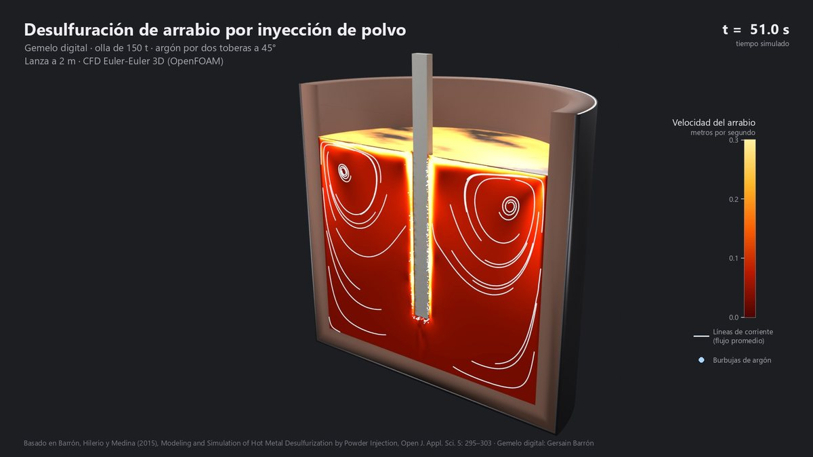
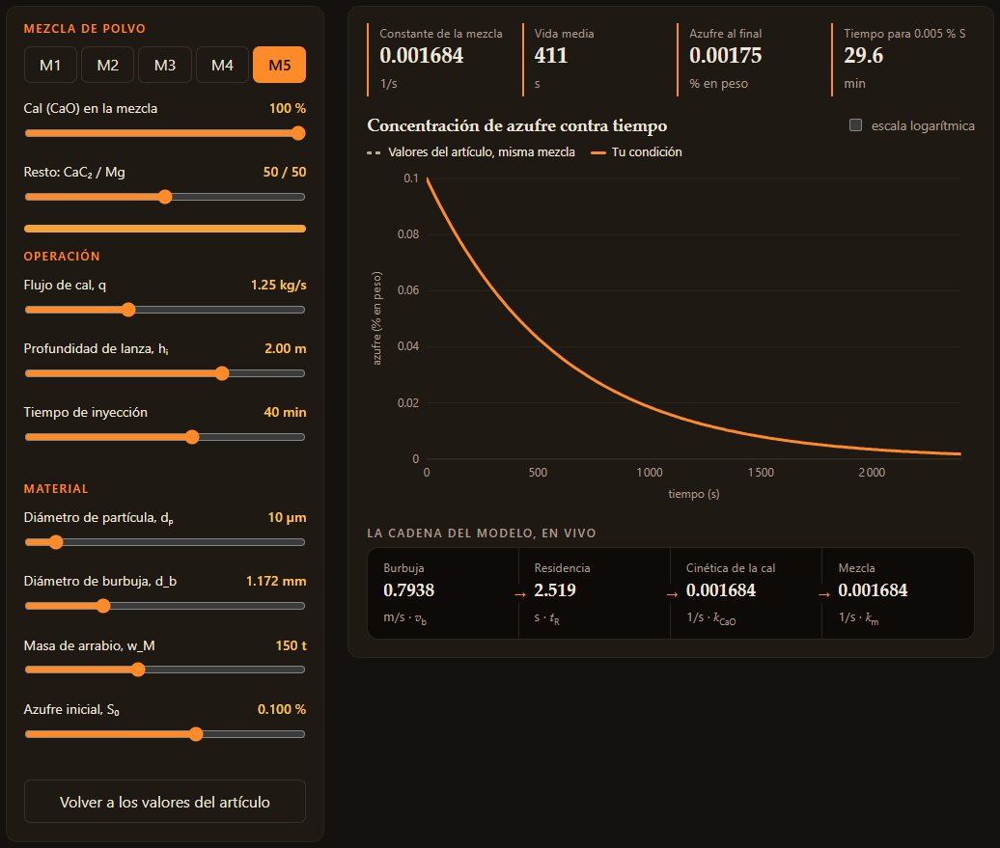
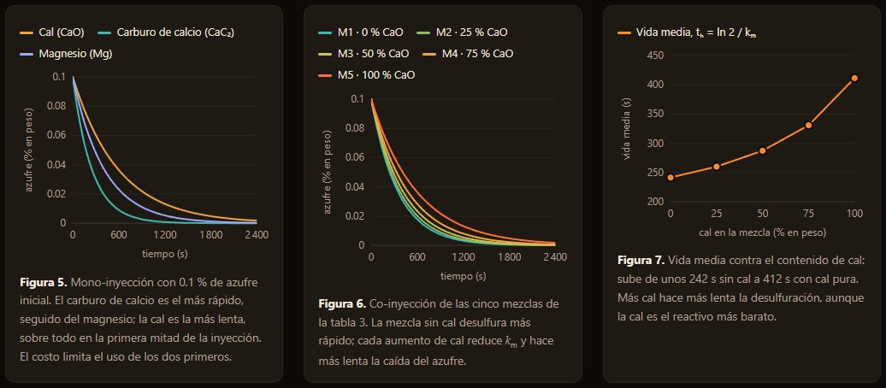
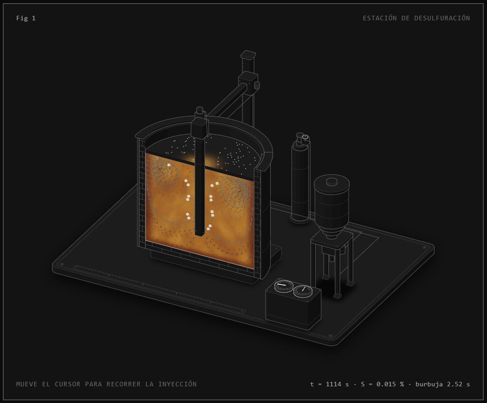
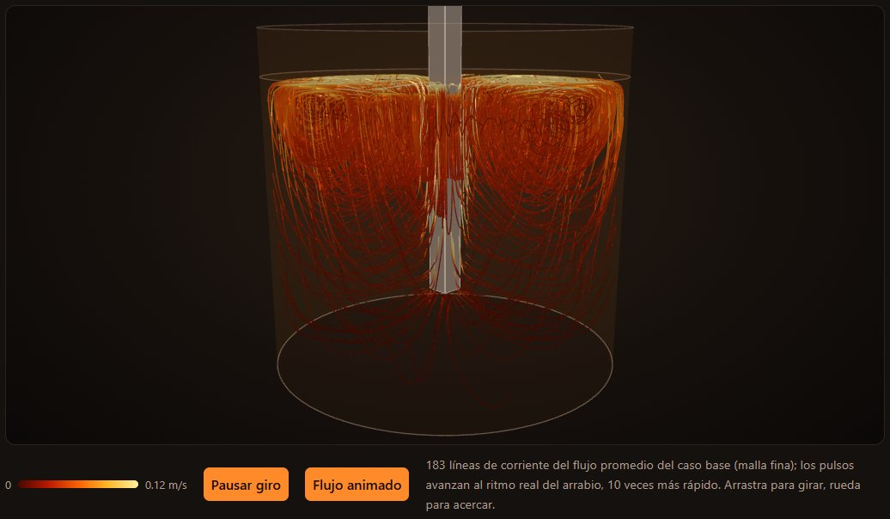

# Desulfuración de arrabio por inyección de polvos — gemelo digital

Gemelo digital interactivo del modelo de **Barrón, Hilerio y Medina (2015)**, *Modeling and Simulation of Hot Metal Desulfurization by Powder Injection*, con una simulación CFD 3D propia de la olla hecha con software libre.

- **El modelo del artículo** corre en vivo en el navegador: controles de operación, curvas de azufre y las figuras 5, 6 y 7 recalculadas.
- **La CFD 3D** de la olla completa se hizo en OpenFOAM: 12 corridas, entre ellas un estudio de malla y un barrido de caudal de gas × profundidad de lanza.
- **Las visualizaciones** se hicieron con esos campos: un corte animado renderizado en Blender, líneas de corriente 3D en three.js y una figura isométrica interactiva de la estación.

Elaborado por **Gersain Barrón**.



---

## Ver la página

La página usa módulos de JavaScript, así que necesita un servidor local (abrir `index.html` con doble clic no basta):

```bash
cd web
python -m http.server 8810
# abrir http://localhost:8810
```

En Windows también sirve `Ver_pagina.bat`. Todo lo que la página necesita ya viene en `web/`: datos, video, three.js y la figura. No descarga nada de internet.

### Qué se ve

**Gemelo interactivo.** Controles de mezcla, operación y material; la curva de azufre, la vida media y la cadena del modelo se recalculan en vivo.



**Figuras 5, 6 y 7 del artículo**, recalculadas con el mismo modelo.



**Fig 1, estación de desulfuración.** La olla está seccionada por la lanza:
- las burbujas suben en el tiempo de residencia del artículo (2.52 s);
- el arrabio se mueve con las líneas de corriente de la CFD;
- la escoria se carga de sulfuro;
- la carátula marca el azufre de la ec. 6.



**Líneas de corriente 3D** del flujo promedio del caso base, en un visor que se puede girar.



## Publicar la página

`web/` es un sitio estático, con rutas relativas y sin compilación. Se puede publicar en cualquier hosting que sirva archivos.

**GitHub Pages:** el repositorio ya trae el flujo `.github/workflows/pages.yml`.
1. En GitHub, ve a *Settings → Pages → Build and deployment* y en *Source* elige **GitHub Actions**.
2. Haz push a `main`, o corre el flujo a mano desde la pestaña *Actions*.
3. La página queda en `https://<usuario>.github.io/<repositorio>/`. Se vuelve a publicar sola cada vez que cambie algo en `web/`.

**Otro hosting** (tu propio sitio, Netlify, un servidor con nginx, etc.): copia el *contenido* de `web/` a la carpeta pública. Puede ir en la raíz o en una subcarpeta, porque todas las rutas son relativas. Para servir el video y los módulos de JavaScript no hace falta configurar nada especial.

## Qué hay en cada carpeta

| Carpeta | Contenido |
|---|---|
| `web/` | La página: `index.html`, estilos, el modelo en JS (`modelo.js`), gráficas SVG propias (`graficas.js`), visor 3D (`visor3d.js`), la figura isométrica (`figura/olla.html`) y los datos y medios ya generados. |
| `modelo/` | El modelo del artículo en Python (`modelo.py`), los parámetros de las tablas 1 a 3 (`parametros.json`) y la validación contra los valores publicados (`validar.py`). |
| `cfd/plantilla/` | Generador del caso de OpenFOAM: geometría, malla, física y condiciones de frontera (`preparar.py`), supuestos con su fuente (`supuestos.json`) y revisiones. |
| `orquestador/` | Cola de corridas desatendida con pausa, reanudación, respaldos y recuperación tras cortes; incluye pruebas con un simulador falso. |
| `extraccion/` | Extracción de campos con ParaView (cortes, flujo promedio, volumen) y cálculo de líneas de corriente. `extraccion/c*/` trae los datos ya extraídos que usa la página. |
| `blender/` | Datos para Blender, escena, render Cycles, rótulos y montaje del video. |
| `figura/` | Construcción de la figura isométrica con el kit *anatomy*. |

## Reproducir

Cada etapa se puede rehacer por separado. La página, el modelo y la figura se reproducen en minutos con lo que trae el repositorio. La CFD, la extracción y el video se reproducen desde cero: los resultados de la simulación (decenas de GB) no se incluyen, así que hay que correrla.

### 1. El modelo (minutos)

Requisitos: Python 3.11+ y Node 20+.

```bash
cd modelo
python validar.py          # 10/10 comprobaciones contra los valores publicados
cd ..
node web/probar_modelo.mjs # el modelo en JS da lo mismo que el de Python (28 puntos)
```

`validar.py` también escribe `figuras.json` con los datos de las figuras 5, 6 y 7.

| Cantidad | Artículo | Este modelo |
|---|---|---|
| Velocidad de burbuja *v*<sub>b</sub> | 0.7938 m/s | 0.7938 m/s |
| Tiempo de residencia *t*<sub>R</sub> | 2.52 s | 2.519 s |
| Constante de la cal *k*<sub>CaO</sub> | 0.001684 1/s | 0.0016845 1/s |
| *k*<sub>m</sub> de las mezclas 1 a 5 | 0.002869 a 0.001684 1/s | igual, con fracción molar |

### 2. La simulación CFD (días de cómputo)

Requisitos: WSL2 con Ubuntu 24.04 y **OpenFOAM v2606** (openfoam.com) en `/usr/lib/openfoam/openfoam2606`. Se usó una laptop con 8 hilos asignados a WSL.

- **Solver:** `twoPhaseEulerFoam`, Euler–Euler argón/arrabio, turbulencia k-ε de mezcla.
- **Olla:** Ø 3.2 m y baño de 2.63 m, con la lanza de 0.2 m. Las dos toberas son de 20 mm a 45° y están modeladas en el caso base.
- **Por caso:** 60 s de flujo simulado; los campos se promedian entre 20 s y 60 s.
- **Mallas:** gruesa de 19 456 celdas, media de 153 344 y fina de 515 520. Una corrida en malla media tarda unas 2.2 h; en malla fina, varias veces más.

Para preparar un caso a mano:

```bash
bash cfd/plantilla/preparar.sh <carpeta_caso> <params.json> <nucleos>
# params.json, por ejemplo:
# {"factor_caudal_gas": 1.0, "profundidad_lanza_m": 2.0, "malla": "fina", "toberas": true}
```

Para correr la cola completa sin intervención:

```bash
python orquestador/generar_cola.py      # estudio de malla + barrido 3 × 3 (orquestador/barrido.json)
python orquestador/encolar.py '{"factor_caudal_gas": 1.0, "profundidad_lanza_m": 2.0, "malla": "fina", "toberas": true}'
bash orquestador/arrancar.sh            # dentro de WSL
```

- **Arranque automático en Windows:** `orquestador/instalar_tarea.ps1` registra una tarea programada que arranca la cola al iniciar sesión y la revisa cada 15 minutos.
- **Pausar y reanudar:** `Pausar.bat` y `Reanudar.bat`. La pausa le pide a OpenFOAM que guarde el instante actual y se detenga limpio.
- **Avance:** se lee en `ESTADO.txt`.
- **Configuración:** `orquestador/config.json` define núcleos, tiempo final, Courant, respaldos y reintentos.

Notas de WSL que costó descubrir:

- `mpirun` se cuelga al sondear GPUs: hay que exportar `HWLOC_COMPONENTS=-gl,-cuda,-nvml,-opencl,-rsmi,-levelzero` (ya está en la configuración) y usar `--use-hwthread-cpus`.
- OpenFOAM no acepta rutas con espacios: los scripts trabajan a través del enlace `~/desulfuracion/proyecto`.
- `timePrecision 12` evita que los nombres de los instantes se trunquen al reanudar.

Los scripts calculan sus rutas desde la carpeta donde estén, así que el repositorio funciona donde lo clones. Tres variables de entorno ajustan lo que cambia de una máquina a otra:

| Variable | Para qué | Por omisión |
|---|---|---|
| `DESULF_WSL` | Distribución de WSL donde está OpenFOAM | `Ubuntu-24.04` |
| `DESULF_PYTHON` | Python con numpy, matplotlib y Pillow (extracción y datos de Blender) | `python3` en WSL, `python` en Windows |
| `BLENDER` | Ejecutable de Blender | `blender` |

Para comprobar el orquestador sin OpenFOAM, con un simulador falso que prueba pausa, reanudación, instantes corruptos, pérdida de WSL y un caso que diverge, corre `bash orquestador/pruebas/prueba.sh`.

### 3. Extracción de campos (minutos por caso)

Requisitos: ParaView 5.11 (`pvpython`) dentro de WSL y Python con numpy.

```bash
bash extraccion/extraer_todo.sh c12     # corte por las toberas, promedio t ≥ 20 s, volumen 65³
cd extraccion
python lineas.py c12                    # líneas de corriente 3D y en el corte
python resumen_barrido.py               # rapidez media y percentil 95 de cada caso
```

### 4. Render en Blender (horas)

Requisitos: Blender 5.x; se usó Cycles con OptiX en una RTX 3080. El render parte de los campos extraídos en el paso 3 (`extraccion/c12/*.npz`), que no vienen en el repositorio: hay que correr antes la CFD y la extracción de ese caso.

```bash
cd blender
python preparar_datos.py c12 4                                        # cuadros del corte, burbujas, colores
blender -b --factory-startup --python escena.py -- c12 animacion      # render de la animación
python rotular.py c12                                                 # título, tiempo, escala y créditos
blender -b --factory-startup --python video.py -- render/c12 render/c12.mp4 24 rotulado_
```

`blender/cadena_caso.ps1` encadena todo, desde esperar la CFD hasta el video.

### 5. La página

```bash
python web/construir_datos.py   # copia datos, video, póster y aligera las líneas 3D para el visor
node figura/build.mjs           # regenera web/figura/olla.html
```

La figura isométrica usa el kit [anatomy](https://github.com/wheresryan22/anatomy) (MIT). Clónalo junto a este repositorio o indica su ruta con `ANATOMY_KIT=/ruta/al/kit`.

## Supuestos y alcances

- **Isotérmico:** el proceso es isotérmico, como en el artículo. La ecuación de Arrhenius (ec. 5) no se usa porque requiere *k*<sub>0</sub> y *E*<sub>a</sub>.
- **Escoria:** no se modela.
- **CFD:** resuelve el flujo de gas y metal, no la química. Las curvas de azufre salen del modelo publicado.
- **Valores supuestos:** el diámetro de la olla, la sección de la lanza, la tensión superficial, la temperatura (1350 °C) y el espacio libre no vienen en el artículo. Son valores típicos de una olla de 150 t, y cada uno está anotado con su fuente en `cfd/plantilla/supuestos.json`.
- **Brillo del metal:** en la figura isométrica es ilustrativo; no es un campo de temperatura calculado.

## Créditos

**Basado en:** Barrón, M. A., Hilerio, I. y Medina, D. Y. (2015). Modeling and Simulation of Hot Metal Desulfurization by Powder Injection. *Open Journal of Applied Sciences*, 5, 295–303. [doi:10.4236/ojapps.2015.56030](https://doi.org/10.4236/ojapps.2015.56030)

**Autores del modelo original:** Miguel A. Barrón, Isaías Hilerio y Dulce Y. Medina, Departamento de Materiales, Universidad Autónoma Metropolitana, Unidad Azcapotzalco, Ciudad de México.

**Datos citados por el artículo:** validación con Oeters (1989), *Metallurgy of Steelmaking*; constante del carburo de calcio de Zhao (1992); constante del magnesio de Irons y Guthrie (1981).

**Esta reinterpretación:** gemelo digital interactivo elaborado por Gersain Barrón con software libre (OpenFOAM, ParaView, Python, Blender, three.js).

## Licencia

El código es **MIT** ([LICENSE](LICENSE)) y los medios propios, **CC BY 4.0**: cualquiera puede usarlos, modificarlos y redistribuirlos dando crédito. El detalle, junto con las licencias de terceros, está en [LICENCIAS.md](LICENCIAS.md).
